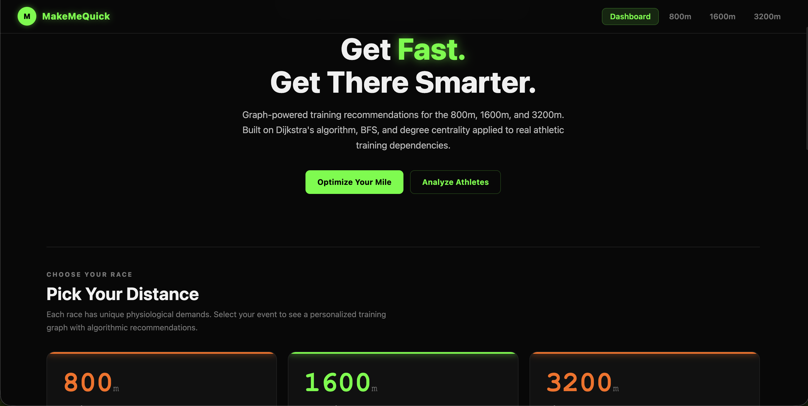
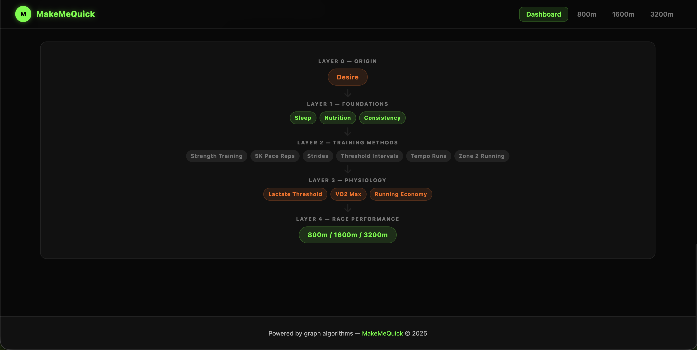
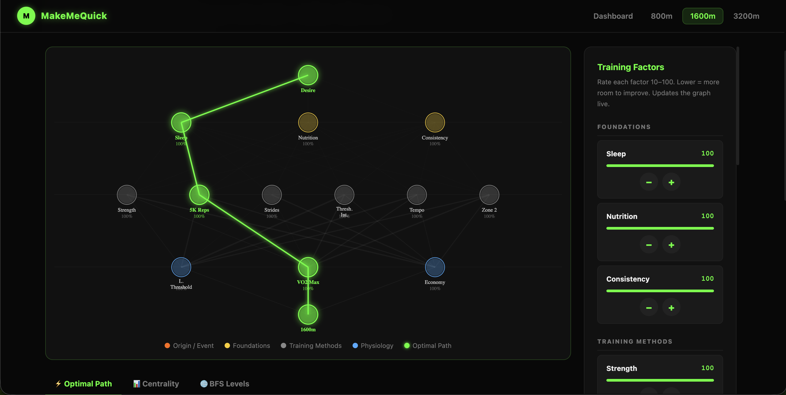
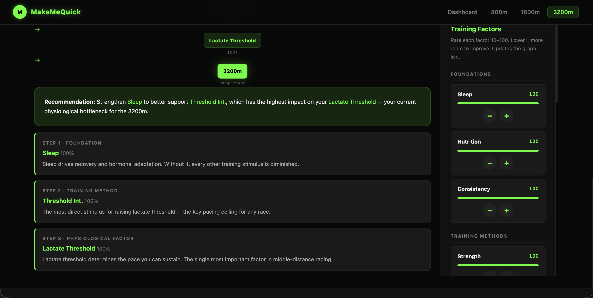

# MakeMeQuick

MakeMeQuick is an interactive running-performance explorer for the 800 m, 1600 m, and 3200 m. It models how training habits and workouts can contribute to physiological qualities and uses graph algorithms to show possible paths from an athlete's current strengths to a race goal.

The project is an educational prototype, not a coaching prescription or a validated performance-prediction system. Its graph and weights are simplified assumptions that are useful for exploring relationships, not measurements of an individual athlete's physiology.

## What it does

- Builds a training graph for the selected race distance.
- Lets you adjust ratings for foundations, training methods, and physiological factors from 10 to 100.
- Recalculates and displays a lowest-cost path, a breadth-first traversal, and a degree-based ranking as ratings change.
- Draws the graph and highlights the path selected by the model.
- Includes an athlete analyzer at `/analyze` that reads a CSV of 800 m, 1600 m, and 3200 m times in the browser and displays heuristic profiles.

## Screenshots

| Dashboard | Training model |
| --- | --- |
|  |  |

| Interactive performance graph | Example recommended path |
| --- | --- |
|  |  |

## The model and the science behind it

The graph represents a simplified chain:

```text
Motivation → Foundations → Training methods → Physiological factors → Race event
```

Its nodes include sleep, nutrition, and consistency; strength training, 5K-pace repetitions, strides, threshold intervals, tempo runs, and Zone 2 running; and VO₂ max, lactate threshold, and running economy. Those categories reflect common concepts in distance-running training: aerobic capacity, the ability to sustain a high fraction of that capacity, and the oxygen cost of running at a given pace all contribute to performance. Recovery, fueling, and consistent training affect an athlete's ability to complete and adapt to training.

These relationships are represented as a conceptual network rather than a physiological simulation. For example, the code assigns hand-selected edge costs between training methods and physiological factors, then uses different edge costs to represent the 800 m, 1600 m, and 3200 m. The values are not fitted to athlete data, sourced from a validated training study, or calibrated to predict race times.

### Graph algorithms

- **Dijkstra's algorithm** finds a minimum-cost route from `Desire` to the chosen race. An edge's cost is the edge weight multiplied by the destination node's rating divided by 100. Lower-rated nodes therefore reduce the cost of paths that lead through them; this is a model-specific way of highlighting possible improvement opportunities, not proof that an athlete should prioritize that factor.
- **Breadth-first search (BFS)** visits connected nodes in increasing edge distance from `Desire`. The graph implementation treats edges as undirected, so its traversal order reflects graph connectivity rather than a strictly one-way training progression.
- **Degree ranking** orders nodes by their number of neighbors multiplied by their rating divided by 100. It gives a simple connectivity-and-rating score; it is not a measure of causal importance.

### Athlete analyzer

The analyzer compares submitted times with rough projections derived from the 1600 m time:

```text
projected 800 m time  = (1600 m time in seconds − 20) / 2
projected 3200 m time = (1600 m time in seconds + 20) × 2
```

It then uses the differences between projected and entered times to assign a profile and a generic training suggestion. These conversions are simple heuristics in the current implementation; they do not account for age, sex, training history, course, conditions, or individual event specialization. Treat the results as an exploratory comparison, not a diagnosis or individualized training plan.

## Run it locally

You need Python 3 and `pip`. Flask is the app's only external Python dependency.

```bash
cd makemequick
python3 -m venv .venv
source .venv/bin/activate
python -m pip install Flask
python app.py
```

On Windows PowerShell, activate the environment with `.venv\Scripts\Activate.ps1` instead. Open <http://127.0.0.1:5000> in your browser. Stop the local server with `Ctrl+C`.

The app runs with Flask's development server and debug mode enabled in `app.py`. Use that setup for local development only; deploy behind a production WSGI server and turn debug mode off before exposing the app to other users.

## Use the app

1. Choose **800m**, **1600m**, or **3200m** from the home page.
2. Use the plus and minus controls to rate each factor from 10 to 100. The values start at 100 and are held for the current page session; reloading resets them.
3. Explore the **Optimal Path**, **Centrality**, and **BFS Levels** tabs to see how the model responds.
4. To use the athlete analyzer, visit <http://127.0.0.1:5000/analyze>. Select a `.csv` file with a header row and columns in this order:

   ```csv
   Name,800m time,1600m time,3200m time
   Alex,2:10,4:40,10:00
   ```

   Times should use `M:SS` format. The analyzer reads the file in the browser; its CSV data is not sent to the Flask server.

## Project structure

```text
makemequick/
├── app.py                 # Flask routes and event-specific graph construction
├── graph.py               # Graph structure, Dijkstra, BFS, and degree ranking
├── Vertex.py              # Graph vertex model
├── templates/
│   ├── home.html          # Landing page and model overview
│   ├── performance.html   # Interactive event graph and algorithm results
│   ├── analyze.html       # Browser-based CSV athlete analyzer
│   └── ...                # Shared layout and page templates
├── static/style.css       # Application styles
└── notes/                 # Original project notes and model outline
```

## Background reading

The original project notes cite these as background for the training concepts:

- [VO₂ max, lactate threshold, and running economy](https://shuichi-running.com/en/vo2max-lactate-threshold-running-economy/)
- [Running-related video](https://www.youtube.com/watch?v=J7mna-hM5v8)

These resources informed the project's conceptual framing; they do not validate the graph weights or analyzer projections.

## Limitations

- The graph is hand-authored and intentionally simplified; it omits many factors such as training history, injury status, age, event tactics, and individual response.
- Ratings and edge weights are illustrative inputs, not measured physiological quantities or evidence-based prescriptions.
- The analyzer uses fixed time conversions and simple rules. It does not estimate race performance or replace a coach or qualified health professional.
- The app currently has no persistent athlete profiles or saved ratings.

## License

No license is currently specified for this project. Contact the repository owner before reusing or distributing the code.
